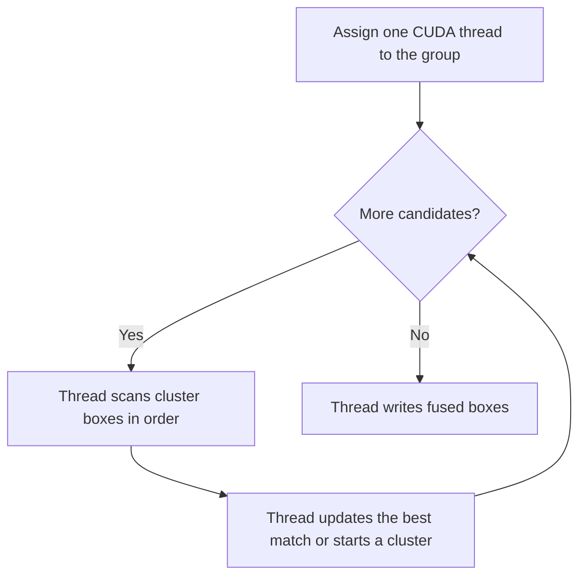
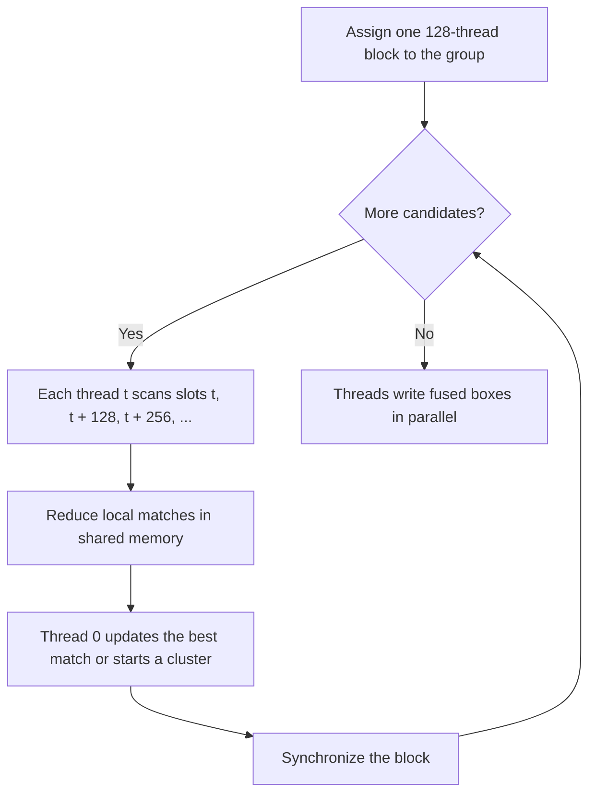

# cuda-wbf

Weighted Boxes Fusion (WBF) for object detection, packaged as `cuda_wbf`. It provides a scalar C++ backend and two optional CUDA backends.

## SHARC benchmark results

On one NVIDIA A100, `cuda_coop` lowered median host-to-host latency across all 48 workloads and was **7.87×–15.18× faster** than single-worker Python WBF on the 12 real COCO workloads. Both CUDA backends matched the Python reference outputs on all 5,000 COCO val2017 images.

AP and AP50 use all 5,000 images. Latency is the range of median host-to-host times per batch across the four COCO detection-count quartiles.

| Method | COCO AP | COCO AP50 | 1 image (ms) | 8 images (ms) | 32 images (ms) |
| --- | ---: | ---: | ---: | ---: | ---: |
| Python WBF | 55.82% | 74.17% | 26.20–69.63 | 205.19–526.98 | 814.13–2,118.02 |
| Scalar C++ WBF | 55.82% | 74.17% | — | — | — |
| `cuda_groups` | 55.82% | 74.17% | 6.11–80.42 | 34.82–124.84 | 90.53–227.17 |
| `cuda_coop` | 55.82% | 74.17% | 3.28–8.47 | 19.73–37.53 | 74.16–139.53 |
| CPU hard NMS | 52.49% | 72.20% | 1.20–2.35 | 10.06–15.60 | 40.84–61.33 |
| CPU Gaussian Soft-NMS | 52.12% | 71.34% | 20.47–58.13 | 156.30–393.84 | 618.71–1,545.51 |
| TorchVision CUDA hard NMS | 52.49% | 72.20% | 0.71–0.91 | 6.20–7.42 | 24.62–28.44 |

The SHARC study evaluated scalar C++ WBF for accuracy only. [Benchmark setup and results](docs/SHARC_BENCHMARK.md) · [Full timing report](docs/benchmarks/sharc-a100/summary.md)

## How the CUDA backends work

The host filters detections, weights their scores, and packs each nonempty image/class pair into a contiguous group sorted by descending weighted score. Within a group, both kernels process one candidate at a time. A candidate joins the cluster with the highest intersection over union (IoU) strictly above the threshold, or starts a new cluster. Equal IoUs favor the earliest-created cluster. Each merge updates the weighted-average box, which the next candidate uses for matching.

### `cuda_groups`

Groups run in parallel, with one CUDA thread scanning each group's current cluster boxes serially. This avoids block-wide reductions and barriers. With disjoint boxes, every candidate creates a cluster, so the number of IoU checks grows quadratically within the group.



### `cuda_coop`

Each group gets one 128-thread block. For each candidate, threads scan cluster slots in strides of 128, then reduce their local best matches in shared memory. Thread 0 creates or updates the winning cluster, and a block-wide barrier makes the update visible before the next candidate. This spreads large scans across the block while preserving the reference's update order.



Both backends reuse GPU buffers and share the same fusion arithmetic. The host compacts and sorts the returned detections. The SHARC kernel-only profiles had median times of **20.38 µs** for `cuda_groups` and **31.52 µs** for `cuda_coop` on one image with 128 overlapping boxes across 16 classes. For 32 images with 2,048 disjoint boxes per image in one class, those times were **1,228.62 ms** and **12.26 ms**, respectively. [CUDA runtime design](docs/CUDA_RUNTIME.md) · [Kernel profiles](docs/SHARC_BENCHMARK.md#measured-results)

## Build and verify

Use Python 3.11, CMake 3.24+, and a C++17 compiler. From the repository root, create the environment and install the CPU build:

```bash
conda env create --file environment.yml
conda activate cuda-wbf
python -m pip install '.[dev,evaluation]'
python -m pytest
python -m cuda_wbf.bench verify --cpu-only
```

### CUDA build

Use a driver-compatible CUDA Toolkit 11.8 or newer. Select the GPU with `CUDA_VISIBLE_DEVICES` before configuring with `native` and running verification. When building without a visible GPU, use an explicit compute capability such as `80` for A100.

```bash
cmake -S . -B build/cuda -DCMAKE_BUILD_TYPE=Release -DWBF_ENABLE_CUDA=ON \
  -DCMAKE_CUDA_ARCHITECTURES=native -DPython_EXECUTABLE="$(command -v python)" \
  -Dpybind11_DIR="$(python -m pybind11 --cmakedir)"
cmake --build build/cuda --parallel
cmake --install build/cuda --prefix "$PWD/build/cuda/stage"
export PYTHONPATH="$PWD/build/cuda/stage"
WBF_TEST_CUDA=1 python -m pytest
python -m cuda_wbf.bench verify
```

See the [CPU validation report](docs/CPU_VALIDATION.md) and [CUDA validation report](docs/CUDA_VALIDATION.md) for parity and sanitizer checks.

## Python API

Call `cuda_wbf.fuse(images, weights, backend="cpp")` with one ordered list of sources per image and one positive weight per source. Each source is a `(boxes, scores, labels)` tuple with normalized `(N, 4)` xyxy boxes, `(N,)` scores in `(0, 1]`, and `(N,)` integer labels. Keep empty source slots with the same array shapes. The function returns one score-ordered tuple per image.

Use `cuda_wbf.available_backends()` to check which backends are compiled.

## COCO benchmark prerequisites

Stage the [prediction archive](https://github.com/ZFTurbo/Weighted-Boxes-Fusion/releases/download/v1.0.5/benchmark.zip) at `data/benchmark.zip`. Extract `annotations/instances_val2017.json` from the [COCO 2017 annotations archive](https://s3.amazonaws.com/images.cocodataset.org/annotations/annotations_trainval2017.zip) to `data/instances_val2017.json`.

Install the evaluation dependency and the CUDA-enabled TorchVision baseline dependencies. These commands use the CUDA 12.8 wheels from the SHARC run:

```bash
python -m pip install pycocotools==2.0.11
python -m pip install torch==2.8.0 torchvision==0.23.0 \
  --index-url https://download.pytorch.org/whl/cu128
```

See the [SHARC benchmark guide](docs/SHARC_BENCHMARK.md#full-study) for the timing and profiling commands, or the [COCO validation report](docs/COCO_VALIDATION.md) for quality checks.

## Repository structure

- [`src/`](src/) contains the scalar C++ implementation, CUDA kernels and workspace, shared fusion arithmetic, and pybind11 bindings.
- [`python/cuda_wbf/`](python/cuda_wbf/) contains the Python API, input validation, COCO evaluation, NMS baselines, and benchmark CLI.
- [`tests/`](tests/) covers API behavior, reference parity, CUDA safety, and the benchmark tooling.
- [`scripts/`](scripts/) contains the CUDA test and Compute Sanitizer runner.
- [`docs/`](docs/) contains the runtime design and validation guides. [`docs/benchmarks/sharc-a100/`](docs/benchmarks/sharc-a100/) holds the published timings, profiles, quality metrics, and run metadata.
- [`CMakeLists.txt`](CMakeLists.txt), [`pyproject.toml`](pyproject.toml), and [`environment.yml`](environment.yml) define the native build, Python package, and development environment. [`.github/workflows/`](.github/workflows/) contains the CPU CI workflow.

See the [implementation plan](IMPLEMENTATION_PLAN.md) for the algorithm and benchmark protocol.
